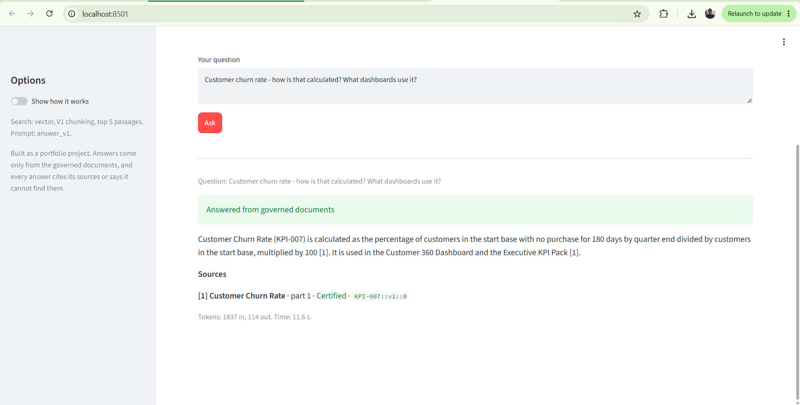
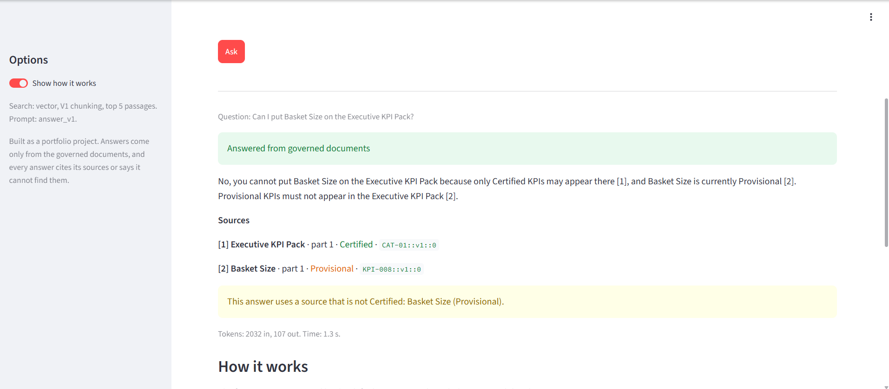
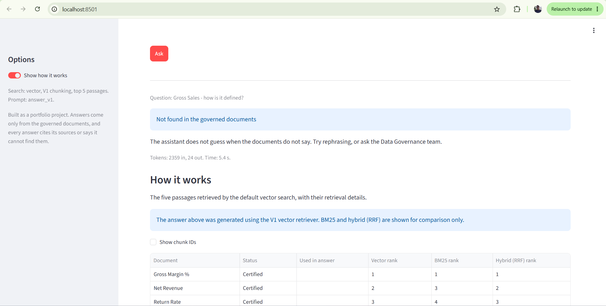
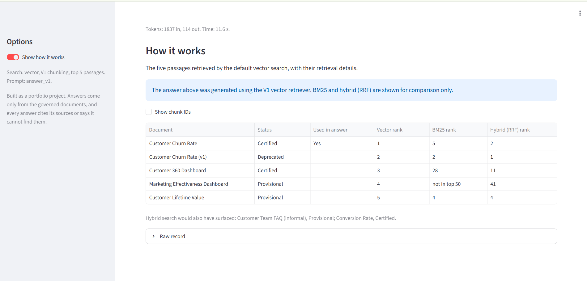
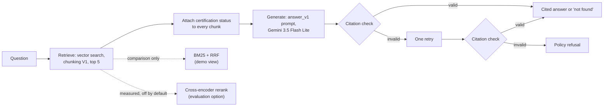

<!-- DRAFT for review. Not in the repo yet. On approval this becomes README.md at the repo root. -->

# KPI Governance Assistant

An experimental retrieval-augmented (RAG) assistant that answers questions about KPI definitions, owners, dashboards and data policies **only from governed documents**. Every answer cites its sources and shows whether each source is Certified, Provisional or Deprecated, or it says "not found".

> **In one sentence:** I built and evaluated a small governed RAG system end to end, measured retrieval and generation behaviour, deliberately kept the best-supported baseline, and documented where the system still fails.

> **Status: experimental and engineering-focused, not production-ready.** This is a prototype built on a synthetic corpus for a fictional company (Kestrel Retail Group). All names, people and numbers are invented. The numbers below come from my own evaluation runs on a 40-question golden set. The point of the project is the measured decisions and the honest failure analysis, not a finished product.



## The problem

In a data governance team the same questions come up every day: how is churn calculated, who owns this KPI, is it approved for board reporting, which dashboard uses it. The answers exist in scattered documents, and the documents disagree. A deprecated churn definition sits next to the current one, and an informal team FAQ says "90 days" where the certified definition says 30.

A generic chatbot can sound right and be wrong. A governance assistant has to do three harder things:

1. answer only from approved documents and show where each claim came from;
2. know which source is Certified, Provisional or Deprecated, and say when a source is not authoritative;
3. refuse when the documents do not contain the answer.

## What it does

| Ask | What you see |
|---|---|
| "Customer churn rate - how is that calculated? What dashboards use it?" | A cited answer. Every source is Certified, so no warning. |
| "Can I put Basket Size on the Executive KPI Pack?" | "No", with two sources, one of them Provisional, and a yellow note naming it. |
| "Gross Sales - how is it defined?" | "Not found in the governed documents." The term appears inside other KPI formulas but is never defined as its own KPI, so the assistant does not invent a formula. |
| "Who owns KPI-020 and what has to be fixed before it can be certified?" | States what must be fixed and says the owner is not stated in the retrieved text. This is a known limit, explained below. |





The sidebar switch **Show how it works** opens a comparison table: the five passages the answer was built from, with vector, BM25 and hybrid ranks side by side.



## How it works



What is on the answer path and what is not:

| Component | Status |
|---|---|
| Vector search, chunking V1, top 5 | **Default answer path** |
| Certification labels on every chunk, citation validation, one retry, refusal | **Always on** |
| `answer_v1` prompt | **Default.** It stayed the default after the holdout evaluation |
| `answer_v2` prompt (adds a completeness rule) | Tested on dev and holdout, **not adopted** (see finding 4) |
| BM25 + RRF hybrid search | **Comparison experiment.** Shown in the demo under "How it works", never feeds the answer. Also an option in the retrieval evaluation (`--retriever hybrid`) |
| Cross-encoder reranking | **Measured, not the default.** Dev result mixed, holdout better on only 8 questions, and about 50 to 100 times slower. Optional in the retrieval evaluation (`--rerank cross-encoder`), not wired into the answer path |

| Stage | What happens |
|---|---|
| Ingest | 50 documents (21 KPI files, 15 data catalog rows, 8 SOPs, 5 policy PDFs, 1 FAQ) are loaded with metadata: owner, certification, version, effective date. |
| Chunk | Fixed windows of about 400 tokens. Every chunk starts with `title (DOC-ID) \| section`, so a document can be found by its code. 52 chunks in total. |
| Retrieve | `BAAI/bge-small-en-v1.5` embeddings (local, 384 dimensions) in Chroma. Top 5 by cosine similarity. |
| Generate | Gemini `gemini-3.5-flash-lite` at temperature 0. Each chunk is labelled with its certification. The prompt says Certified and current sources govern, conflicts must be named, and "not found" is the right answer when the context does not say. |
| Validate | In code: every cited chunk must have been retrieved, and a refusal must not cite anything. One retry with the rejected IDs named, then a policy refusal. |
| Log | Every call is one line in `results/traces.jsonl`, including rejected attempts. |

## What the experiments showed

Full write-up with every table: [`results/experiments.md`](results/experiments.md). Decisions and evidence: [`docs/decisions.md`](docs/decisions.md).

Default configuration, on a 40-question golden set (30 dev, 10 holdout, 8 unanswerable):

| Result | Dev | Holdout |
|---|---|---|
| Retrieval recall@5 / hit@5 / MRR@10 (document level) | 0.815 / 1.000 / 0.938 | 0.729 / 0.875 / 0.646 |
| Key-fact coverage of answers | 75.6% (59 of 78) | 60.9% (14 of 23) |
| Faithful answers (every claim supported by the sources) | 22 of 22 | 8 of 8 |
| Unanswerable questions refused correctly | 6 of 6 | 2 of 2 |
| Wrong refusals of answerable questions | 2 | 0 |

Median model-call time on the dev set was 4.6 s on the free tier.

Five findings:

1. **Plain vector search was the best default.** Equal-weight hybrid search (BM25 + RRF) lost to vector on dev in all three chunkings. Cross-encoder reranking was mixed on dev, better on an 8-question holdout, and about 50 to 100 times slower. Both stay in the code as options in the retrieval evaluation. Hybrid also appears as a read-only comparison in the demo.
2. **Retrieval rank is not source authority.** Reranking pulled the informal, conflicting FAQ into the top 5 on 11 dev questions instead of 7. Governance therefore lives in generation: certification labels on every chunk plus prompt rules.
3. **A rubric bug can pick the winner.** My first check of the LLM judge against hand grades missed its bar (80.6% against 85%). All six misses were one question whose key facts asked for role titles when the question asked for teams. I fixed it, logged both numbers, and agreement became 100%.
4. **A more "complete" prompt was rejected.** `answer_v2` added one rule ("state every key fact") and covered 4 more of 101 facts, but on the holdout it answered a KPI-owner question with an inference from an action owner. The pass rule I wrote before the run failed on faithfulness, so `answer_v1` stays the default.
5. **Most remaining misses are retrieval misses.** Broad list questions and a question that mentions a bare KPI code did not retrieve all the needed documents, and no prompt change can fix missing evidence. In the demo, hybrid search does not retrieve the missing KPI-020 document either.

## Run it

Windows, PowerShell, Python 3.12 (3.11 works).

```powershell
python -m venv .venv
.venv\Scripts\Activate.ps1

# CPU build of PyTorch first, then the rest
pip install torch --index-url https://download.pytorch.org/whl/cpu
pip install -r requirements.txt

# Gemini key (free tier, from Google AI Studio) and model ID
copy .env.example .env
#   edit .env: GEMINI_API_KEY=...   LLM_MODEL=gemini-3.5-flash-lite

$env:PYTHONPATH = "src"

# Build the index (once)
python -m rag.ingest
python -m rag.chunking
python -m rag.index --variant all

# Ask from the command line
python -m rag.ask "How many days do we use to count an Active Customer?"

# Or open the demo
streamlit run app/streamlit_app.py
```

The first run downloads the embedding model (about 130 MB). Generated data in `data/index/` and `data/processed/` is not committed.

Tests and evaluation:

```powershell
pytest                                                   # unit tests, no network needed

python -m eval.retrieval_eval --variant v1 --retriever vector --no-log
python -m eval.generation_eval run --version answer_v1 --split dev --pause 5 --out results/generation/my_run_dev.jsonl
python -m eval.generation_eval judge --input results/generation/my_run_dev.jsonl --judge-model gemini-3.5-flash-lite --pause 5
python -m eval.generation_eval report --inputs results/generation/my_run_dev.judged.jsonl
```

The generation evaluation calls Gemini, so it uses your free-tier quota (set `JUDGE_MODEL` in `.env` or pass `--judge-model`). Use `--out` as shown so you do not overwrite the recorded runs. The holdout split is guarded: it needs `--confirm-holdout` and each version is logged once.

## Repository map

| Path | What is in it |
|---|---|
| `src/rag/` | The pipeline: `ingest`, `chunking`, `index`, `bm25`, `fusion` and `hybrid` (RRF), `rerank`, `generate`, `validate`, `pipeline`, `ask`, and the demo (`demo_view` for pure logic, `demo_ui` for the page) |
| `app/streamlit_app.py` | Demo launcher |
| `eval/` | Retrieval and generation evaluation, judge sanity check, hand-grading tool |
| `golden/golden_set.jsonl` | The 40 questions with expected documents and key facts |
| `prompts/` | Answer prompts `answer_v1` and `answer_v2`, and the two judge prompts. A prompt version that has been run is never edited |
| `data/raw/`, `data/corpus_manifest.csv` | The synthetic corpus and its metadata |
| `results/` | `experiments.md`, `runs.csv` (every retrieval run), `generation/` (answers, judged results, hand grades, holdout log) |
| `docs/` | `decisions.md`, learning notes, golden-set audit, tracker, screenshots |
| `tests/` | About 250 tests (the exact number depends on installed packages). Model calls are passed in as functions, so tests use fakes and need no network |

## Design choices and trade-offs

| Choice | Why | Cost |
|---|---|---|
| No LangChain or LlamaIndex, plain Python | I wanted to be able to explain every line | More code to maintain |
| One wrapper for all model calls (`llm.py`) | Changing provider is a one-file change | One more layer |
| Local embeddings and Chroma | Free, fast on CPU, nothing to host | Does not scale past a small corpus |
| Governance in the prompt and metadata, not in retrieval | Rankers do not know which source is authoritative | A prompt rule can still be ignored, so the citation check and the evaluation matter |
| Citation check in code, one retry | Catches citations to chunks that were never retrieved, cheaply | Checks form only: it cannot prove that a chunk supports a claim. That is what the judge is for |
| Holdout run once, pass rule written first | Prevents tuning to the test set | Cannot fix a prompt after seeing a holdout failure without new questions |

## Limits

- 40 questions, with 8 answerable holdout questions. One holdout question moves retrieval recall by 0.125 and one key fact moves coverage by about 4 points. The results show direction, not proof.
- The corpus is synthetic and has 52 chunks. Retrieval depth results will not transfer to a large corpus.
- 25 of the 40 questions were drafted with Claude and reviewed by me. Retrieval is scored at document level.
- The judge and the answer model are the same model. I checked the judge against 10 hand-graded answers, but only 2 of the 31 human grades were negative, so leniency is weakly tested.
- Temperature 0 is not fully repeatable. The same question about Active Customer cited the informal FAQ in the dev run and only the certified definition in two later demo runs.
- The citation retry has been tested with forced failures only. No real model answer has triggered it.
- Known failures: broad list questions (G-006, G-015) are wrongly refused, and questions that name a bare KPI code (G-028) can miss the KPI document. I did not tune against them.
- Three holdout questions have soft key facts (G-004, G-028, G-032). They were listed before the run and not changed.
- Free-tier latency includes queueing and is not a production benchmark.

## Beyond this prototype (not built)

A production implementation would require managed vector and search infrastructure, model and prompt versioning, observability, access controls, evaluation monitoring and stronger governance enforcement. These are discussed conceptually here and are **not implemented in this project**. In more detail:

- Replace local Chroma with a managed vector store and apply certification and domain filters at query time.
- Filter results by the asking user's entitlements before retrieval. The corpus already includes a data classification standard (POL-03) to drive this.
- Read certification status from the catalog system of record, not from a manifest file.
- Re-ingest on document change, with versioned chunk IDs and re-embedding.
- Grow the golden set well past 40 questions, and run the judge and the holdout guard on every prompt or retrieval change.
- Revisit hybrid search with tuned weights and a reranker on a corpus large enough to need them, scored on fresh questions.
- Add dashboards over the existing per-call traces for cost, latency, refusal rate and citation failures.
- Keep the model wrapper as the single place to swap provider.

## Author

Jaishri Rai. Built as a learning project in RAG engineering. The build log, decisions and learning notes are in `docs/`.
